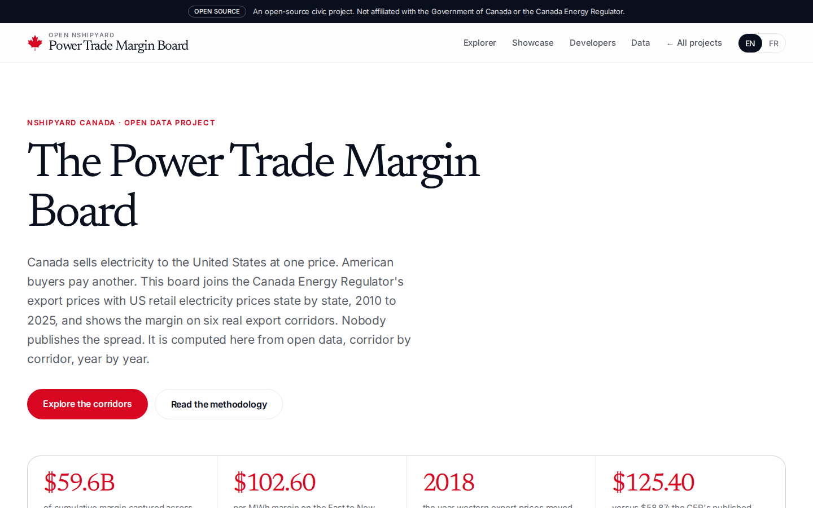
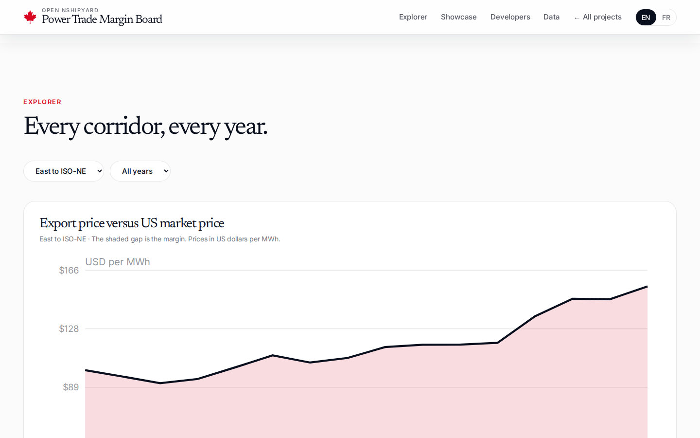
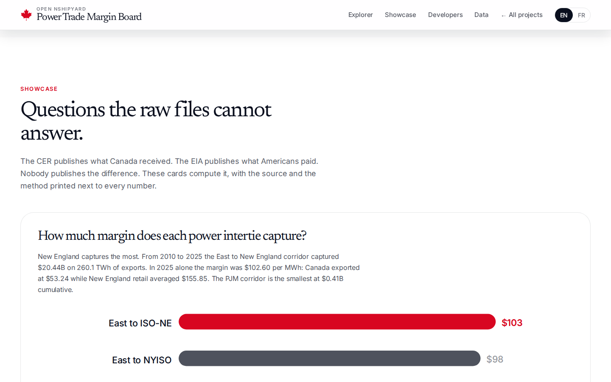
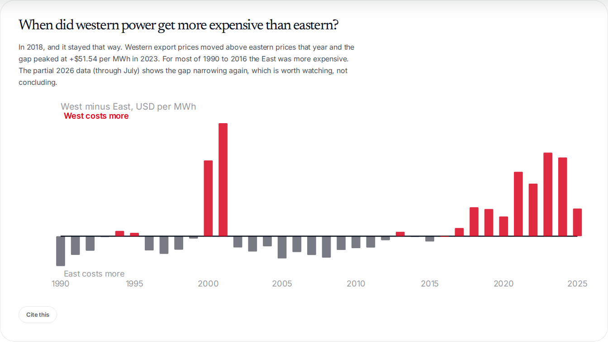
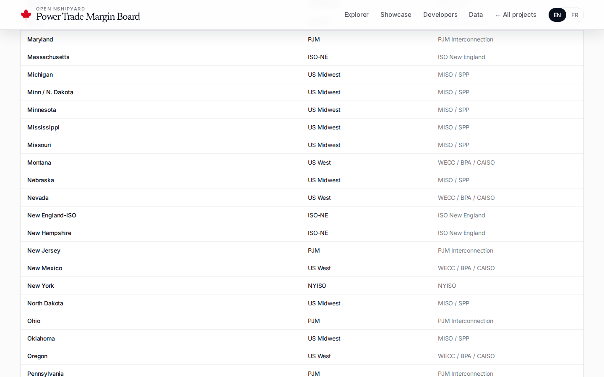
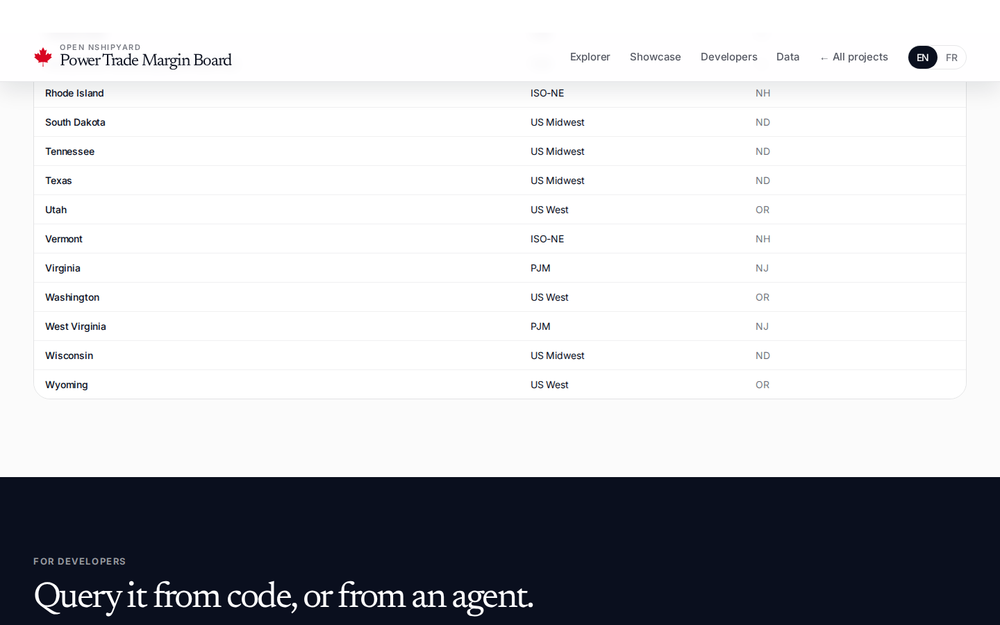
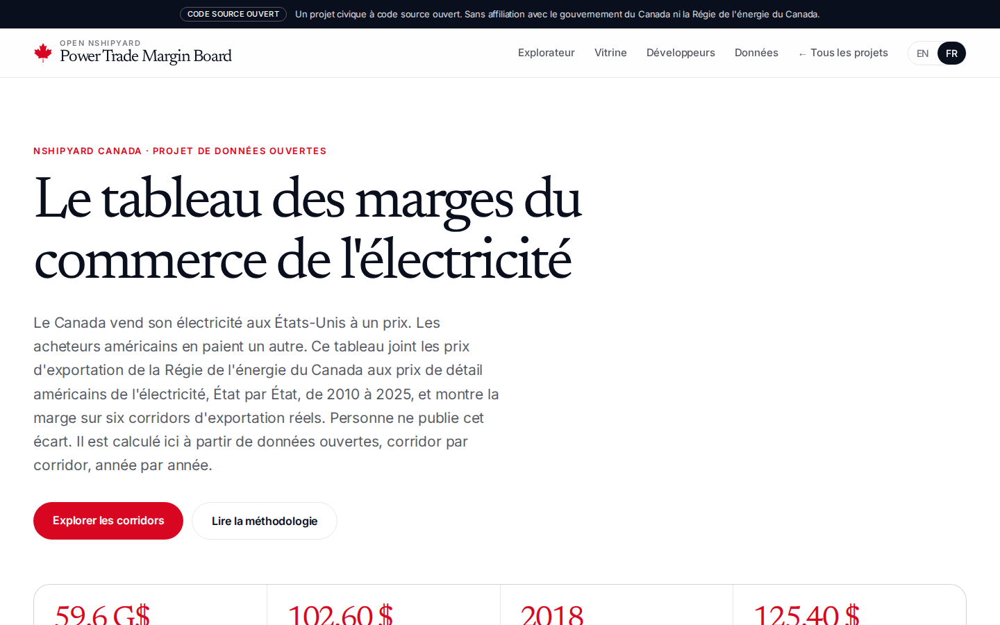
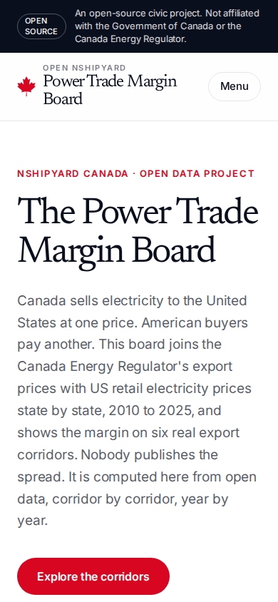
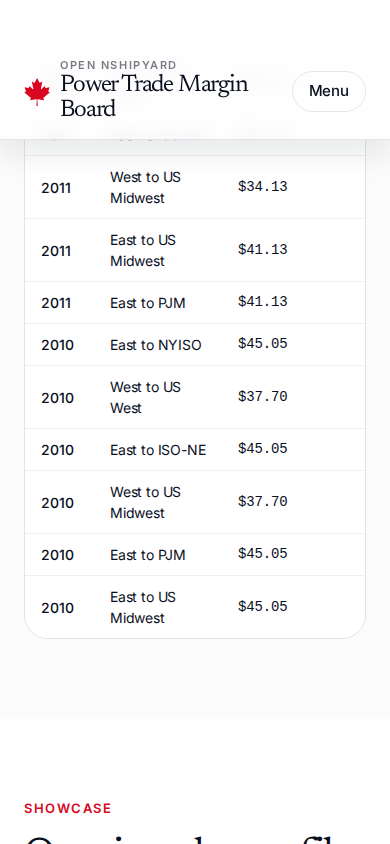

# canada-power-trade

The Power Trade Margin Board: Canada's electricity export prices (Canada Energy Regulator) joined with US state retail electricity prices (US Energy Information Administration), 2010 to 2025, across six export corridors. The margin spread neither government publishes, computed from open data corridor by corridor, year by year.

Canada sells electricity to the United States at one price. American buyers pay another. In 2025, the East to New England corridor captured $102.60 per MWh of margin: Canada exported at $53.24 while New England retail averaged $155.85. Over 2010 to 2025 the six corridors captured $59.6B of cumulative margin. Western export prices moved above eastern prices in 2018 and stayed there, peaking at +$51.54 per MWh in 2023; for most of 1990 to 2016 the East was more expensive.

An open-source civic project. Not affiliated with the Government of Canada or the Canada Energy Regulator.

## Screenshots











## Data

All sources keyless, retrieved 2026-10-10. The pipeline is `scripts/build-data.py`; every number on the site is recomputed from the sources below.

- Export prices: Canada Energy Regulator, Electricity Trade Summary XLSX (updated 2026-09-25; monthly West and East export prices 2010-01 to 2026-07, annual volumes 2010-2026, annual province-to-destination flows 2010-2026) and the archived quarterly imports-exports CSV (1990Q1-2018Q2, via open.canada.ca dataset 76e6795d-eace-4def-b12b-911fde9a5adc).
- US prices: US Energy Information Administration, Form 861 annual files 2010-2025 (utility-level retail revenue and sales aggregated to annual state average retail price, USD/MWh).
- Currency: Bank of Canada FXAUSDCAD annual average 2017-2025, FRED DEXCAUS daily averaged annually for 1990-2016, BoC FXMUSDCAD monthly average for 2026.
- `data/margins_annual.csv`: 96 rows, margin per corridor per year, 2010-2025, USD/MWh with volumes and margin values.
- `data/inversion_annual.csv`: West vs East export prices, 1990-2026, CAD and USD per MWh.
- `data/export_prices_annual.csv`: 181 corridor-year export prices from the archived CER quarterly file, 1990-2018.
- `data/us_basket_prices_annual.csv`: US market-region retail prices, 2010-2025, USD per MWh.
- `data/crosswalk.csv`: the hand-curated destination-to-market-region crosswalk (55 rows) plus origin province groupings.
- Downloads (CSV) are served from `public/data/`.

Validation: the pipeline reproduces the CER's published 2024 anchors exactly ($125.40 CAD/MWh West, $58.87 CAD/MWh East). Honest limits: US retail prices include distribution, so the margin overstates the pure wholesale spread; the 2019-2025 corridor export prices use the CER's West/East regional prices because the archived province-by-destination file ends in 2018Q2; 2026 CER data runs only through July.

## Site

Next.js 16, English and French. Pages: corridor explorer (corridor and year filters, margin-spread chart, full data table), the "Questions the raw files cannot answer" showcase (ranked margin bars, East-West inversion timeline, two margin-spread charts, each with a "Cite this" button), methodology with the crosswalk table and the quarantine log, REST API (`/api/v1/*`) with OpenAPI 3.1 docs, MCP tools over streamable HTTP (`/mcp`), and downloadable CSVs.

## API

- `GET /api/v1/margins?corridor=East%20to%20ISO-NE&year=2025`
- `GET /api/v1/corridors`
- `GET /api/v1/inversion`
- `GET /api/v1/crosswalk`
- `GET /api/v1/summary`
- `GET /api/openapi.json`
- `POST /mcp` (tools: `export_lookup`, `margin_trend`, `intertie_ranking`)

## Development

```bash
python3 scripts/build-data.py   # rebuild derived data from the live sources (downloads ~60MB of EIA files to /tmp)
npm install
npm run build
npm start
```

## Suggested domain

`powertrade.canada.nshipyard.com` (alternates: `powermargins.canada.nshipyard.com`, `electronspread.canada.nshipyard.com`)

## Author

Richardson Dackam: [X](https://x.com/richardsondx) · [GitHub](https://github.com/richardsondx)

## License

MIT
